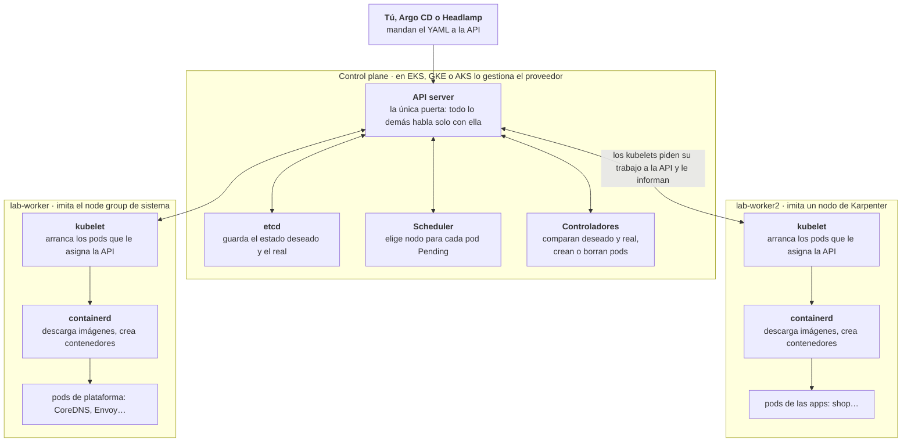
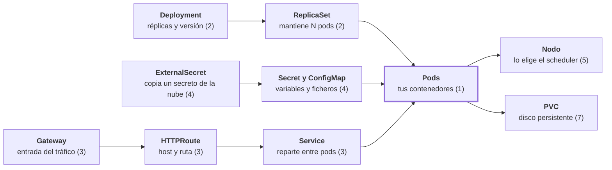

# Laboratorio de Kubernetes por niveles

[English](README.md)

Un laboratorio práctico de Kubernetes, desde cero hasta operar una plataforma EKS de producción, en nueve niveles. Todo corre en local con [kind](https://kind.sigs.k8s.io/). Los manifiestos copian los patrones de una plataforma real: GitOps con Argo CD, Gateway API con Envoy, External Secrets, node pools al estilo Karpenter y kube-prometheus-stack.

El nivel 5 reproduce un incidente real: el rolling update de un DaemonSet se atasca porque el nodo está lleno de requests. Lo arreglas con cordon, drain y uncordon, y luego lo evitas con overprovisioning.

## Elige tu camino

| Si quieres… | Empieza por | Necesitas |
| --- | --- | --- |
| Aprender Kubernetes desde cero y operarlo como un equipo de plataforma | [Niveles 1–9](#niveles), en orden. Del 1 al 4 son los fundamentos; del 5 al 9, trabajo de plataforma | El clúster kind de abajo |
| Preparar el examen CKAD | [Pista CKAD](ckad/README.es.md). Haz antes los niveles 1–4 si `kubectl` es nuevo para ti | El clúster kind de abajo |
| Entender cómo se sirven los LLM (GPUs, KV cache, batching, gateways) | [Notas de inferencia](inference/README.es.md), en orden | Un navegador; un servidor de modelos local para los ejemplos con `curl` |

Los tres caminos son independientes: puedes hacer las notas de inferencia sin el clúster, y la pista CKAD sin los niveles si ya dominas lo básico.

## Niveles

Cada nivel tiene su `README.es.md`.

| Nivel | Tema | Practicarás |
| --- | --- | --- |
| [1](level-1/README.es.md) | Fundamentos | Pods, namespaces, `kubectl`, leer eventos |
| [2](level-2/README.es.md) | Workloads | Deployment, ReplicaSet, StatefulSet, DaemonSet, Job, probes, rolling update |
| [3](level-3/README.es.md) | Red | Service, DNS del clúster, Gateway API con Envoy, NetworkPolicy |
| [4](level-4/README.es.md) | Configuración e identidad | ConfigMap, Secret, External Secrets, ServiceAccount, RBAC |
| [5](level-5/README.es.md) | Scheduling y nodos | Requests y allocatable, Pending, cordon/drain, PDB, PriorityClass, overprovisioning |
| [6](level-6/README.es.md) | Helm y GitOps | Charts, values, ApplicationSets de Argo CD, un bump de imagen como el de la CI |
| [7](level-7/README.es.md) | Almacenamiento y nube | PVC, volúmenes por zona, lo que vive fuera del clúster |
| [8](level-8/README.es.md) | Observabilidad | Prometheus, Grafana, ServiceMonitor, alertas |
| [9](level-9/README.es.md) | Operación | Un método de diagnóstico y cinco averías para encontrar a ciegas |

## Preparar el CKAD

La [pista CKAD](ckad/README.es.md) añade doce ejercicios contra reloj para lo que pide el examen y no cubren los niveles: CronJobs, sidecars nativos, SecurityContext, quotas, Ingress, Kustomize, Helm, canary, RBAC, CRDs y construir una imagen. Arranca uno con `./lab.sh drill <n>` y corrígelo con `./lab.sh drill <n> check`.

## Dos mapas

**Verlo en 3D:** un [clúster isométrico interactivo](https://albegosu.github.io/k8s-levels-lab/es.html) donde puedes escalar, borrar pods, desplegar una versión nueva, hacer drain de un nodo y añadir uno de Karpenter, y ver cómo reacciona cada controlador. Es un único HTML en [`docs/`](docs/es.html), así que también puedes abrirlo en local. Lo acompaña el [recorrido de una petición](https://albegosu.github.io/k8s-levels-lab/request.es.html): sigue a `curl` por el DNS, el balanceador, Envoy, la HTTPRoute y el Service hasta el pod, con nueve averías que puedes activar y un modo de diagnóstico a ciegas.

Cómo funciona un clúster: todo pasa por la API. El control plane decide y los nodos ejecutan.



Por eso un `kubectl apply` no arranca nada él solo: deja escrito el estado deseado y cada pieza hace su parte.

Cómo se conectan los objetos: todo gira alrededor del pod. Entre paréntesis, el nivel donde se explica cada uno.



Cuando algo falla, sigue las flechas hacia atrás. Si no hay pods, mira el Deployment y el ReplicaSet. Si el pod no arranca, mira sus secretos, su nodo y su disco. Si arranca pero no le llega tráfico, mira el Service, la HTTPRoute y el Gateway.

## Requisitos

- Docker (Docker Desktop, OrbStack o Colima) con al menos 6 GB de memoria; 8 GB si instalas la monitorización.
- `kind`, `kubectl`, `helm` y `yq`. Opcional: `k9s`.

```bash
brew install kind kubectl helm yq k9s
```

## Arrancar

```bash
./lab.sh up        # clúster kind de 3 nodos + metrics-server + Envoy Gateway + External Secrets
./lab.sh status
```

Añadidos opcionales, cuando llegues a su nivel:

```bash
./lab.sh addon headlamp     # interfaz web del clúster, útil desde el nivel 1
./lab.sh addon argocd       # nivel 6
./lab.sh addon monitoring   # nivel 8
```

Ejecuta todos los comandos desde la raíz del repositorio. Comprueba siempre el contexto: `kubectl config current-context` tiene que decir `kind-lab`.

## Corregir tu progreso

Cada nivel acaba con un check que mira el clúster y te dice qué está hecho y qué falta, con una pista para cada tarea que falla:

```bash
LAB_LANG=es ./lab.sh check 3      # un nivel
LAB_LANG=es ./lab.sh check all    # todos
./lab.sh progress                 # qué niveles has superado
./lab.sh progress --open          # lo mismo como página: una escalera de niveles, los hechos en verde
```

Un nivel cuenta como superado cuando pasan todas sus tareas; la fecha se guarda en `.progress`, fuera de Git. Si tu sistema está en español, `LAB_LANG=es` ya viene por defecto.

## Los nodos

| Nodo | Imita | Notas |
| --- | --- | --- |
| `lab-control-plane` | El control plane gestionado (oculto en EKS, GKE, AKS) | Tiene un taint: no acepta pods normales |
| `lab-worker` | Un node group fijo de "sistema" | Label `role=system` |
| `lab-worker2` | Un nodo pequeño creado por Karpenter | Label `karpenter.sh/nodepool=default`, ~2,4 GiB allocatable |

## Verlo en pantalla

**Headlamp** muestra los nodos con sus requests, los pods de cada nodo, los eventos y el YAML de cada objeto:

```bash
./lab.sh addon headlamp
kubectl create token headlamp -n headlamp --duration=24h | pbcopy
kubectl port-forward svc/headlamp -n headlamp 4466:80
```

Abre `http://localhost:4466` y pega el token. Su ServiceAccount es `cluster-admin`: vale para un laboratorio, nunca para un clúster real.

**k9s** hace lo mismo en la terminal: `k9s --context kind-lab`. Contra clústeres reales, usa `k9s --readonly`. Lo básico: `:pods`, `:nodes`, `:deploy`, `:events`; `0` todos los namespaces; `d` describe; `l` logs; `y` YAML; `/` filtrar; `?` ayuda.

## Qué se puede y qué no se puede practicar en kind

| Se practica en kind | Solo se lee |
| --- | --- |
| Pods, Deployments, StatefulSets, DaemonSets, Jobs | Karpenter y NodePools |
| Services, Gateway API con Envoy, NetworkPolicy | Balanceadores, certificados gestionados y DNS de la nube |
| External Secrets (provider fake), RBAC | IRSA / workload identity, gestores de secretos de la nube |
| Scheduling, cordon, drain, PDB, PriorityClass | Terraform y Atlantis |
| Helm, Argo CD con un repo Git local | Loki, Alloy, Tempo |
| Prometheus, Grafana, Alertmanager | Velero |

## Empezar de cero

```bash
./lab.sh down && ./lab.sh up
```

## Licencia

[MIT](LICENSE)
