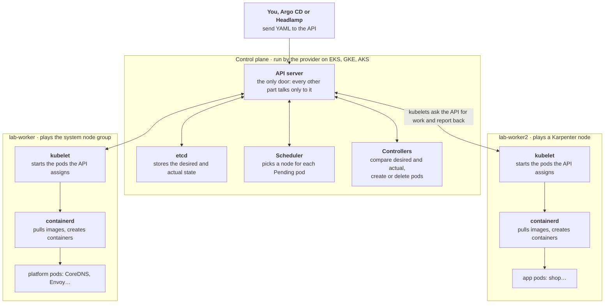
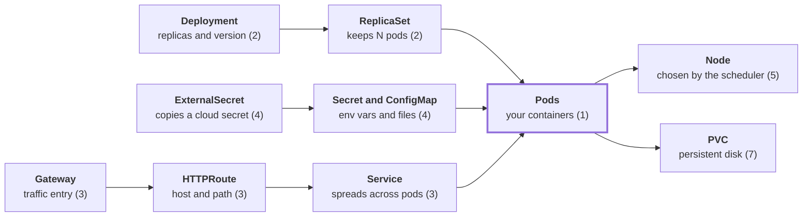

# Kubernetes levels lab

[Español](README.es.md)

A hands-on Kubernetes lab, from zero to running a production-style EKS platform, in nine levels. Everything runs locally on [kind](https://kind.sigs.k8s.io/). The manifests copy the patterns of a real platform: GitOps with Argo CD, Gateway API with Envoy, External Secrets, Karpenter-style node pools and kube-prometheus-stack.

Level 5 reproduces a real incident: a DaemonSet rollout gets stuck because the node is full of resource requests, and you fix it with cordon, drain and uncordon, then prevent it with overprovisioning.

## Levels

| Level | Topic | You will practise |
| --- | --- | --- |
| [1](level-1/README.md) | Fundamentals | Pods, namespaces, `kubectl`, reading events |
| [2](level-2/README.md) | Workloads | Deployment, ReplicaSet, StatefulSet, DaemonSet, Job, probes, rolling updates |
| [3](level-3/README.md) | Networking | Service, cluster DNS, Gateway API with Envoy, NetworkPolicy |
| [4](level-4/README.md) | Config and identity | ConfigMap, Secret, External Secrets, ServiceAccount, RBAC |
| [5](level-5/README.md) | Scheduling and nodes | Requests vs allocatable, Pending, cordon/drain, PDB, PriorityClass, overprovisioning |
| [6](level-6/README.md) | Helm and GitOps | Charts, values, Argo CD ApplicationSets, a CI-style image bump |
| [7](level-7/README.md) | Storage and cloud | PVCs, zonal volumes, what lives outside the cluster |
| [8](level-8/README.md) | Observability | Prometheus, Grafana, ServiceMonitor, alerts |
| [9](level-9/README.md) | Operations | A diagnosis method and five faults to find blind |

## Two maps

**See it in 3D:** an [interactive isometric cluster](https://albegosu.github.io/k8s-levels-lab/) where you can scale, delete pods, roll out a new version, drain a node and add a Karpenter node, and watch each controller react. It is a single HTML file in [`docs/`](docs/index.html), so you can also open it locally. Its companion, the [path of a request](https://albegosu.github.io/k8s-levels-lab/request.html), follows `curl` through DNS, the load balancer, Envoy, the HTTPRoute and the Service to the pod, with nine faults to switch on and a blind-diagnosis mode.

How a cluster works: everything goes through the API. The control plane decides and the nodes do the work.



That is why `kubectl apply` starts nothing by itself: it writes the desired state, and each part does its job.

How the objects connect: everything revolves around the pod. The level that covers each object is in brackets.



When something breaks, follow the arrows backwards. No pods: check the Deployment and ReplicaSet. Pod does not start: check its secrets, its node and its disk. Pod runs but gets no traffic: check the Service, HTTPRoute and Gateway.

## Requirements

- Docker (Docker Desktop, OrbStack or Colima) with at least 6 GB of memory; 8 GB if you install monitoring.
- `kind`, `kubectl`, `helm` and `yq`. Optional: `k9s`.

```bash
brew install kind kubectl helm yq k9s
```

## Start

```bash
./lab.sh up        # 3-node kind cluster + metrics-server + Envoy Gateway + External Secrets
./lab.sh status
```

Optional add-ons, when you reach their level:

```bash
./lab.sh addon headlamp     # web UI for the cluster, useful from level 1
./lab.sh addon argocd       # level 6
./lab.sh addon monitoring   # level 8
```

Run every command from the repository root. Always check your context first: `kubectl config current-context` must say `kind-lab`.

## Check your progress

Every level ends with a check that inspects the cluster and tells you what is done and what is missing, with a hint for each failed task:

```bash
./lab.sh check 3      # one level
./lab.sh check all    # every level
./lab.sh progress     # which levels you have passed
./lab.sh progress --open   # the same as a page: a staircase of levels, done ones in green
```

A level counts as passed when all its tasks pass; the date is kept in `.progress`, outside Git. Set `LAB_LANG=es` for messages in Spanish.

## The nodes

| Node | Plays | Notes |
| --- | --- | --- |
| `lab-control-plane` | The managed control plane (hidden on EKS, GKE, AKS) | Tainted: no regular pods |
| `lab-worker` | A fixed "system" node group | Label `role=system` |
| `lab-worker2` | A small node created by Karpenter | Label `karpenter.sh/nodepool=default`, ~2.4 GiB allocatable |

## Seeing it

**Headlamp** shows nodes with their requests, pods per node, events and the YAML of every object:

```bash
./lab.sh addon headlamp
kubectl create token headlamp -n headlamp --duration=24h | pbcopy
kubectl port-forward svc/headlamp -n headlamp 4466:80
```

Open `http://localhost:4466` and paste the token. Its ServiceAccount is `cluster-admin`: fine for a lab, never for a real cluster.

**k9s** does the same in the terminal: `k9s --context kind-lab`. Against real clusters, use `k9s --readonly`. Basics: `:pods`, `:nodes`, `:deploy`, `:events`; `0` all namespaces; `d` describe; `l` logs; `y` YAML; `/` filter; `?` help.

## What kind can and cannot teach

| Practised on kind | Read about only |
| --- | --- |
| Pods, Deployments, StatefulSets, DaemonSets, Jobs | Karpenter and NodePools |
| Services, Gateway API with Envoy, NetworkPolicy | Cloud load balancers, managed certificates, DNS |
| External Secrets (fake provider), RBAC | IRSA / workload identity, cloud secret managers |
| Scheduling, cordon, drain, PDB, PriorityClass | Terraform and Atlantis |
| Helm, Argo CD with a local Git repo | Loki, Alloy, Tempo |
| Prometheus, Grafana, Alertmanager | Velero |

## Start over

```bash
./lab.sh down && ./lab.sh up
```

## License

[MIT](LICENSE)
