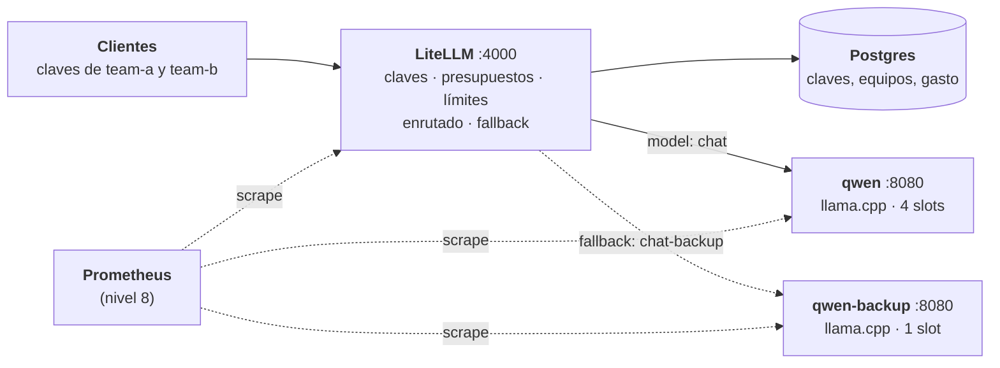

# Nivel 10 · Plataforma de inferencia

[English](README.md)

Monta en el clúster kind, en CPU, todo el camino de una plataforma de LLM: un servidor de modelos con API compatible con OpenAI, un gateway LiteLLM con tenants, rate limits, presupuestos y fallback, métricas en Prometheus y Grafana, y averías para diagnosticar a ciegas. Es la parte práctica de las [notas de inferencia](../inference/README.es.md): lo que allí se explica en papel, aquí lo ves, lo mides y lo rompes.

Usa unos 2 GB más de memoria (3 GB mientras se reinicia el gateway), más 1,5 GB de monitorización si no tienes el nivel 8. La primera vez descarga unos 2 GB de imágenes y un modelo de 400 MB.



## El lab frente a producción

El lab es pequeño y lento, pero cada pieza tiene su gemela en producción. Ten esta tabla a mano; las preguntas de cada tarea te piden traducir.

| En el lab | En producción | Nota de inferencia |
| --- | --- | --- |
| Servidor llama.cpp en CPU, Qwen2.5 0.5B en 4 bits | vLLM en GPUs, un modelo de 70B o MoE en FP8 | 01, 19 |
| `--ctx-size 4096 --parallel 4`: 4 slots de 1.024 tokens | Memoria de KV cache y `--max-num-seqs`, `--max-model-len` | 11, 13, 20 |
| `llamacpp:requests_processing` / `requests_deferred` | `vllm:num_requests_running` / `num_requests_waiting` | 22 |
| `load.sh` | `vllm bench serve`, GuideLLM | 21 |
| Modelo descargado de Hugging Face al arrancar (segundos) | Pesos ya colocados cerca del nodo (si no, minutos) | 24 |
| `maxSurge: 0`: el pod viejo se va antes de que arranque el nuevo | Un nodo con GPU no tiene sitio para una segunda copia del modelo | 24 |
| Un precio por token inventado | El coste real por token, del precio del nodo y su utilización | 18 |

## 1. El servidor de modelos

```bash
kubectl apply -f level-10/model.yaml
kubectl get pods -n inference -w            # espera a que qwen y qwen-backup estén Ready
kubectl logs -n inference deploy/qwen | grep -E 'n_slots|listening'
```

La línea `n_slots = 4, n_ctx_slot = 1024` es todo el modelo de capacidad de este servidor: 4 peticiones a la vez, de hasta 1.024 tokens cada una (prompt más respuesta). Háblale directamente, sin gateway:

```bash
kubectl port-forward svc/qwen -n inference 8080:8080 &
curl -s localhost:8080/v1/models | jq '.data[].id'
curl -s localhost:8080/v1/chat/completions -H 'Content-Type: application/json' \
  -d '{"model":"qwen2.5-0.5b","max_tokens":50,"messages":[{"role":"user","content":"What is a Kubernetes pod?"}]}' | jq '.usage, .timings'
curl -s localhost:8080/metrics | grep -v '^#'
```

Preguntas:

- En `.timings`, compara `prompt_per_second` con `predicted_per_second`. ¿Qué fase es más rápida por token y por qué (nota 04)?
- ¿Cómo serían esos dos números para un modelo de 70B en una H100 (nota 18, ecuaciones 3 y 4)?

## 2. El gateway

```bash
./level-10/secrets.sh            # random Postgres password and master key, straight into Secrets
kubectl apply -f level-10/postgres.yaml -f level-10/litellm.yaml
kubectl rollout status deploy/litellm -n inference --timeout=5m
kubectl port-forward svc/litellm -n inference 4000:4000 &
export MASTER=$(kubectl get secret litellm -n inference -o jsonpath='{.data.LITELLM_MASTER_KEY}' | base64 -d)
curl -s localhost:4000/v1/models -H "Authorization: Bearer $MASTER" | jq '.data[].id'
```

Lee `level-10/litellm.yaml`: los clientes solo conocen el nombre `chat`; el gateway lo traduce a un servidor, con un precio y un fallback. La master key es la clave de administración; nadie debería usarla para tráfico. No hay ninguna credencial escrita en el YAML: `secrets.sh` las genera directamente en Secrets, y por eso los ficheros pueden estar en Git (el nivel 4 hace lo mismo con External Secrets).

## 3. Tenants

```bash
./level-10/tenants.sh
export KEY_A=$(kubectl get secret tenant-keys -n inference -o jsonpath='{.data.team-a}' | base64 -d)
export KEY_B=$(kubectl get secret tenant-keys -n inference -o jsonpath='{.data.team-b}' | base64 -d)
curl -s localhost:4000/v1/chat/completions -H "Authorization: Bearer $KEY_A" -H 'Content-Type: application/json' \
  -d '{"model":"chat","max_tokens":30,"messages":[{"role":"user","content":"hi"}]}' | jq '.choices[0].message.content'
curl -s localhost:4000/key/info -H "Authorization: Bearer $KEY_A" | jq '.info | {key_alias, team_id, models, rpm_limit, spend}'
```

`team-a` tiene 60 peticiones por minuto y ningún presupuesto; `team-b`, 2 peticiones por minuto y un presupuesto de 0,02, más o menos una petición.

## 4. Concurrencia: encuentra el codo

El generador de carga corre dentro del clúster e imprime códigos de estado, percentiles de latencia y tokens/s totales:

```bash
./level-10/load.sh 1 4
./level-10/load.sh 4 8
./level-10/load.sh 8 16
```

Rellena esta tabla (tus números serán otros; la forma no):

| Concurrencia | Latencia p50 | Tokens/s totales |
| --- | --- | --- |
| 1 | | |
| 4 | | |
| 8 | | |

Mientras corre la prueba con 8, en otro terminal: `curl -s localhost:8080/metrics | grep -E 'processing|deferred'`.

Preguntas:

- De 1 a 4, los tokens/s totales crecen mucho y la latencia casi no se mueve. De 4 a 8, la latencia crece y los tokens/s casi no. ¿Por qué justo 4 (tarea 1)? ¿Qué ecuación de la nota 18 explica cada mitad?
- Hay 4 peticiones en `deferred`. ¿Cómo se llama esa métrica en vLLM y qué techo de la nota 20 es?
- Cambia `--parallel` a 8 en `model.yaml` (deja `--ctx-size 4096`), aplícalo y repite. ¿Qué has ganado y qué ha perdido cada petición?

## 5. Límites, presupuestos y fallback

**Rate limit y presupuesto.** Manda tres peticiones como `team-b`, espera un minuto y manda otra:

```bash
./level-10/load.sh 1 3 team-b
sleep 70; ./level-10/load.sh 1 1 team-b
```

Los primeros errores son `429` (rate limit, inmediato). El último es `422 budget_exceeded`: el gasto se escribe en Postgres por lotes, así que un presupuesto corta el tráfico con retraso. Un tenant puede pasarse un poco; es normal en LiteLLM y conviene contárselo a los clientes.

**Fallback.** Quita el servidor principal y llama al gateway como `team-a`:

```bash
kubectl scale deploy/qwen -n inference --replicas=0
./level-10/load.sh 1 1 team-a
```

Falla con 500. Lee el mensaje que imprime el generador de carga: el fallback está en la configuración, pero se ha saltado. Averigua por qué con `/key/info` y arréglalo para `team-a` con la master key y `/key/update` (documentación de LiteLLM: "Virtual keys"). Repite la petición: debería funcionar, servida por `qwen-backup`. Vuelve a escalar `qwen` a 1.

Preguntas:

- ¿Por qué es buena idea limitar los modelos a los que puede llamar una clave, y qué rompe?
- Con `maxSurge: 0` y una réplica, ¿qué les pasa a los usuarios en cada rollout de `qwen`? ¿Qué dos cosas de este nivel reducen el impacto (nota 24)?

## 6. Métricas, dashboard y alertas

```bash
./lab.sh addon monitoring        # si no has hecho el nivel 8
kubectl apply -f level-10/monitoring.yaml
kubectl port-forward svc/kps-grafana -n observability 3000:80 &
```

Grafana en `http://localhost:3000` (admin / lab) → Dashboards → **Inference lab**. Sus cuatro filas siguen la nota 22: ¿están bien los usuarios?, ¿cómo de lleno está?, ¿cuánto trabajo?, ¿quién y cuánto? Lanza `./level-10/load.sh 8 64` y mira las filas 1–3.

Lee `level-10/monitoring.yaml`:

- LiteLLM protege `/metrics`, así que el ServiceMonitor envía un bearer token sacado de un Secret. ¿Qué usarías en lugar de la master key en una plataforma real?
- llama.cpp no tiene histogramas de latencia, así que las alertas de latencia salen del gateway. ¿Qué métricas de vLLM usarías en su lugar (nota 23)?
- Deja `./level-10/load.sh 8 64` corriendo 3 minutos y abre Prometheus → Alerts: `ModelRequestsQueued` pasa a pending y luego a firing. ¿Por qué es un ticket y no un aviso a guardia?

## 7. Cinco averías, a ciegas

```bash
./level-10/break.sh            # mete una avería al azar y no te dice cuál
```

Los usuarios lo notan en uno o dos minutos. Diagnostica con los cinco pasos de la nota 25 (métrica, capa, fase, techo, cambio) usando solo `kubectl`, `load.sh` (también con `LONG=1`, un prompt largo), los errores del gateway, Grafana y los logs. Arréglala **en su sitio** y escribe el mensaje de tres frases para el cliente (nota 26).

```bash
./level-10/break.sh reveal     # qué avería era
./level-10/break.sh reset      # deshace todas las averías; luego prueba la siguiente
./level-10/break.sh 3          # o elige una: de 1 a 5
```

Compara con [solutions.es.md](solutions.es.md) solo cuando hayas escrito tu diagnóstico.

## Comprueba tu trabajo

```bash
./lab.sh check 10
```

## Lo que kind no puede enseñar aquí

GPUs (scheduling, el device plugin y el GPU Operator, MIG, métricas DCGM), el throughput real, tensor parallelism y serving en varios nodos, y tiempos de carga del modelo de minutos. Eso está en las notas de inferencia 19–24 y en los casos de [inference/practice](../inference/practice/README.md).

## Limpiar

```bash
./level-10/break.sh reset 2>/dev/null; kubectl delete namespace inference
kubectl delete configmap inference-lab-dashboard -n observability
```
