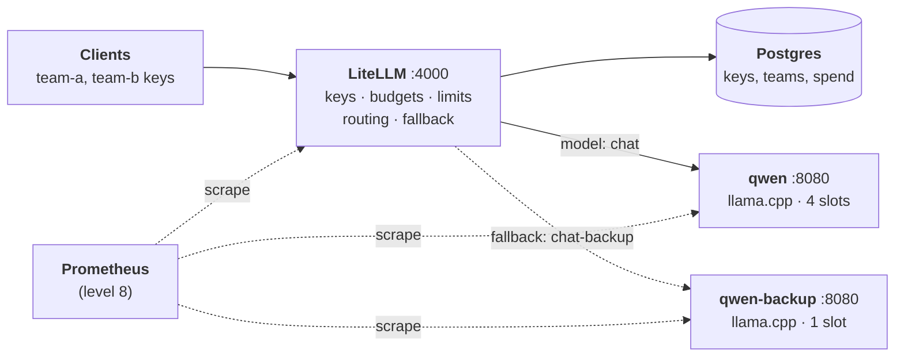

# Level 10 · Inference platform

[Español](README.es.md)

Run the whole serving path of an LLM platform on the kind cluster, on CPU: a model server with an OpenAI-compatible API, a LiteLLM gateway with tenants, rate limits, budgets and a fallback, metrics in Prometheus and Grafana, and faults to diagnose blind. It is the hands-on companion of the [inference notes](../inference/README.md): what they explain on paper, here you see, measure and break.

Uses about 2 GB more memory (3 GB while the gateway restarts), plus 1.5 GB for monitoring if level 8 is not installed. The first run downloads about 2 GB of images and a 400 MB model.



## Lab against production

The lab is small and slow, but every piece has a production twin. Keep this table in mind; the questions in each task ask you to translate.

| In the lab | In production | Inference note |
| --- | --- | --- |
| llama.cpp server on CPU, Qwen2.5 0.5B in 4-bit | vLLM on GPUs, a 70B or MoE model in FP8 | 01, 19 |
| `--ctx-size 4096 --parallel 4`: 4 slots of 1,024 tokens | KV cache memory and `--max-num-seqs`, `--max-model-len` | 11, 13, 20 |
| `llamacpp:requests_processing` / `requests_deferred` | `vllm:num_requests_running` / `num_requests_waiting` | 22 |
| `load.sh` | `vllm bench serve`, GuideLLM | 21 |
| Model downloaded from Hugging Face at start-up (seconds) | Weights pre-staged near the node (minutes otherwise) | 24 |
| `maxSurge: 0`: the old pod goes before the new one starts | A GPU node has no room for a second copy of the model | 24 |
| A made-up price per token | Real cost per token, from node price and utilisation | 18 |

## 1. The model server

```bash
kubectl apply -f level-10/model.yaml
kubectl get pods -n inference -w            # wait for qwen and qwen-backup Ready
kubectl logs -n inference deploy/qwen | grep -E 'n_slots|listening'
```

The log line `n_slots = 4, n_ctx_slot = 1024` is the whole capacity model of this server: 4 requests at once, up to 1,024 tokens each (prompt plus answer). Talk to it directly, without the gateway:

```bash
kubectl port-forward svc/qwen -n inference 8080:8080 &
curl -s localhost:8080/v1/models | jq '.data[].id'
curl -s localhost:8080/v1/chat/completions -H 'Content-Type: application/json' \
  -d '{"model":"qwen2.5-0.5b","max_tokens":50,"messages":[{"role":"user","content":"What is a Kubernetes pod?"}]}' | jq '.usage, .timings'
curl -s localhost:8080/metrics | grep -v '^#'
```

Questions:

- In `.timings`, compare `prompt_per_second` with `predicted_per_second`. Which phase is faster per token, and why (note 04)?
- What would the same two numbers look like for a 70B model on an H100 (note 18, equations 3 and 4)?

## 2. The gateway

```bash
./level-10/secrets.sh            # random Postgres password and master key, straight into Secrets
kubectl apply -f level-10/postgres.yaml -f level-10/litellm.yaml
kubectl rollout status deploy/litellm -n inference --timeout=5m
kubectl port-forward svc/litellm -n inference 4000:4000 &
export MASTER=$(kubectl get secret litellm -n inference -o jsonpath='{.data.LITELLM_MASTER_KEY}' | base64 -d)
curl -s localhost:4000/v1/models -H "Authorization: Bearer $MASTER" | jq '.data[].id'
```

Read `level-10/litellm.yaml`: clients only know the name `chat`; the gateway maps it to a server, with a price and a fallback. The master key is the admin key; nobody should use it for traffic. No credential is written in the YAML: `secrets.sh` generates them into Secrets, which is why the files can live in Git (level 4 does the same with External Secrets).

## 3. Tenants

```bash
./level-10/tenants.sh
export KEY_A=$(kubectl get secret tenant-keys -n inference -o jsonpath='{.data.team-a}' | base64 -d)
export KEY_B=$(kubectl get secret tenant-keys -n inference -o jsonpath='{.data.team-b}' | base64 -d)
curl -s localhost:4000/v1/chat/completions -H "Authorization: Bearer $KEY_A" -H 'Content-Type: application/json' \
  -d '{"model":"chat","max_tokens":30,"messages":[{"role":"user","content":"hi"}]}' | jq '.choices[0].message.content'
curl -s localhost:4000/key/info -H "Authorization: Bearer $KEY_A" | jq '.info | {key_alias, team_id, models, rpm_limit, spend}'
```

`team-a` has 60 requests per minute and no budget; `team-b` has 2 requests per minute and a budget of 0.02, about one request.

## 4. Concurrency: find the knee

The load generator runs inside the cluster and prints status codes, latency percentiles and total tokens/s:

```bash
./level-10/load.sh 1 4
./level-10/load.sh 4 8
./level-10/load.sh 8 16
```

Fill in this table (your numbers will differ, the shape will not):

| Concurrency | p50 latency | Total tokens/s |
| --- | --- | --- |
| 1 | | |
| 4 | | |
| 8 | | |

While the run with 8 is going, in another terminal: `curl -s localhost:8080/metrics | grep -E 'processing|deferred'`.

Questions:

- From 1 to 4, total tokens/s grew a lot and latency barely moved. From 4 to 8, latency grew and tokens/s barely moved. Why exactly 4 (task 1)? Which equation of note 18 explains each half?
- 4 requests are `deferred`. What is the vLLM name of that metric, and which ceiling of note 20 is this?
- Change `--parallel` to 8 in `model.yaml` (keep `--ctx-size 4096`), apply, and rerun. What did you gain, and what did each request lose?

## 5. Limits, budgets and the fallback

**Rate limit and budget.** Send three requests as `team-b`, then wait a minute and send another:

```bash
./level-10/load.sh 1 3 team-b
sleep 70; ./level-10/load.sh 1 1 team-b
```

The first errors are `429` (rate limit, immediate). The later one is `422 budget_exceeded`: spend is written to Postgres in batches, so a budget stops traffic with a delay. A tenant can overspend a little; that is normal for LiteLLM and worth telling customers.

**Fallback.** Take the main server away and call the gateway as `team-a`:

```bash
kubectl scale deploy/qwen -n inference --replicas=0
./level-10/load.sh 1 1 team-a
```

It fails with 500. Read the message the load generator prints: the fallback exists in the config but was skipped. Find out why with `/key/info` and fix it for `team-a` with the master key and `/key/update` (LiteLLM docs: "Virtual keys"). Then send the request again: it should succeed, served by `qwen-backup`. Scale `qwen` back to 1.

Questions:

- Why is restricting the models a key can call a good idea, and what does it break?
- With `maxSurge: 0` and one replica, what happens to users during every rollout of `qwen`? What two things in this level reduce the impact (note 24)?

## 6. Metrics, dashboard and alerts

```bash
./lab.sh addon monitoring        # if you have not done level 8
kubectl apply -f level-10/monitoring.yaml
kubectl port-forward svc/kps-grafana -n observability 3000:80 &
```

Grafana at `http://localhost:3000` (admin / lab) → Dashboards → **Inference lab**. Its four rows follow note 22: are users OK, how full is it, how much work, who and how much. Run `./level-10/load.sh 8 64` and watch rows 1–3.

Read `level-10/monitoring.yaml`:

- LiteLLM protects `/metrics`, so the ServiceMonitor sends a bearer token from a Secret. What would you use instead of the master key on a real platform?
- llama.cpp has no latency histograms, so latency alerts come from the gateway. Which vLLM metrics would you use instead (note 23)?
- Keep `./level-10/load.sh 8 64` running for 3 minutes and open Prometheus → Alerts: `ModelRequestsQueued` goes pending, then firing. Why is it a ticket and not a page?

## 7. Five faults, blind

```bash
./level-10/break.sh            # injects a random fault and does not tell you which
```

Users notice within a minute or two. Diagnose with the five steps of note 25 (metric, layer, phase, ceiling, change) using only `kubectl`, `load.sh` (also with `LONG=1`, a long prompt), the gateway errors, Grafana and the logs. Then fix it **in place**, and write the three-sentence message to the customer (note 26).

```bash
./level-10/break.sh reveal     # which fault was it
./level-10/break.sh reset      # undo every fault, then try the next
./level-10/break.sh 3          # or pick one: 1 to 5
```

Compare with [solutions.md](solutions.md) only after you have written your diagnosis.

## Check your work

```bash
./lab.sh check 10
```

## What kind cannot teach here

GPUs (scheduling, the device plugin and GPU Operator, MIG, DCGM metrics), real throughput, tensor parallelism and multi-node serving, and model loading times of minutes. Those are in inference notes 19–24 and the cases in [inference/practice](../inference/practice/README.md).

## Clean up

```bash
./level-10/break.sh reset 2>/dev/null; kubectl delete namespace inference
kubectl delete configmap inference-lab-dashboard -n observability
```
